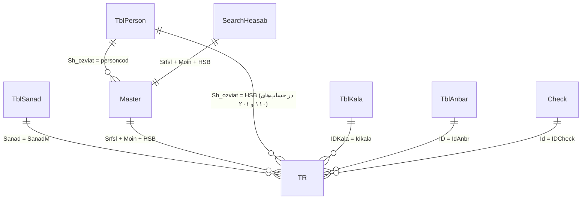

# 🧠 راهنمای جامع معماری و دانش عمیق پایگاه داده و نرم‌افزار حسابداری سپهریار (نسخه زنده و رسمی)

این سند عصاره کامل و تحلیل شده از ساختار ۶۷۶ جدول، ۵۵۷ سرفصل، ۶,۹۵۷ پروسیجر و پایگاه داده فعال سپهریار (`Sepehr_Main2_1405`) می‌باشد که به عنوان مغز دانش حسابداری و هوش مصنوعی سیستم عمل می‌کند.

---

## ۱. ساختار کدینگ حسابداری و سرفصل‌های رسمی سپهریار

کدینگ سپهریار ۳ سطحی و مبتنی بر استاندارد زیر است:
* **سطح ۱: سرفصل کل (Srfsl)** - ۳ رقمی
* **سطح ۲: سرفصل معین (Moin)** - ۱ الی ۲ رقمی
* **سطح ۳: کد تفصیلی (HSB / personcod)** - متناظر با شخص یا حساب خرد

### ۱.۱. جدول سرفصل‌های کل و معین استخراج‌شده از ویوی مرجع `SearchHeasab`:
| کد کل (Srfsl) | نام سرفصل کل | کد معین (Moin) | نام سرفصل معین | نوع ماهیت |
| :---: | :--- | :---: | :--- | :---: |
| **۱۰۰** | موجودی نقد و بانک | **۱** | صندوق | بدهکار |
| **۱۰۰** | موجودی نقد و بانک | **۲** | بانک‌ها | بدهکار |
| **۱۱۰** | حساب‌های دریافتنی تجاری (مشتریان) | **۱** | مشتریان و خریداران تجاری | بدهکار |
| **۱۱۲** | اسناد دریافتنی تجاری | **۱** | اسناد دریافتنی (چک‌های اشخاص) | بدهکار |
| **۱۱۷** | سایر حساب‌های دریافتنی | **۱** | بدهکاران متفرقه | بدهکار |
| **۱۱۷** | سایر حساب‌های دریافتنی | **۲** | موجودی پایان دوره | بدهکار |
| **۱۲۰** | موجودی مواد و کالا | **۱** | موجودی انبار کالا | بدهکار |
| **۲۰۱** | حساب‌های پرداختنی تجاری | **۱** | بستانکاران و تأمین‌کنندگان | بستانکار |
| **۲۰۲** | اسناد پرداختنی تجاری | **۱** | اسناد پرداختنی (چک‌های صادره) | بستانکار |
| **۳۵۰** | سرمایه و حقوق صاحبان سهام | **۱** | سرمایه ثبت شده | بستانکار |
| **۳۵۰** | سرمایه و حقوق صاحبان سهام | **۲** | سود و زیان انباشته | بستانکار/بدهکار |
| **۴۰۰** | درآمد و فروش | **۱** | حساب فروش کالا و خدمات | بستانکار |
| **۴۰۰** | درآمد و فروش | **۳** | برگشت از فروش و تخفیفات | بدهکار |
| **۵۰۰** | بهای تمام شده کالای خریداری شده | **۱** | حساب خرید کالا | بدهکار |
| **۵۰۰** | بهای تمام شده کالای خریداری شده | **۳** | برگشت از خرید و تخفیفات | بستانکار |
| **۵۲۰** | هزینه‌های عمومی و اداری | **۱ الی ۹** | حقوق، اجاره، آب/برق، حق‌الزحمه | بدهکار |
| **۵۲۵** | هزینه‌های توزیع و فروش | **۱ الی ۱۳** | آگهی، پورسانت، حمل و انبارداری | بدهکار |
| **۵۳۰** | هزینه‌های مالی | **۱ الی ۶** | سود و کارمزد وام، تمبر، جرایم | بدهکار |
| **۵۹۰** | هزینه‌های غیرعملیاتی | **۱ الی ۶** | زیان تسعیر ارز، زیان فروش دارایی | بدهکار |
| **۷۰۰** | حساب‌های انتظامی | **۱** | اسناد ضمانتی دریافتنی | انتظامی |
| **۷۰۱** | طرف حساب‌های انتظامی | **۲** | طرف اسناد ضمانتی | انتظامی |
| **۹۰۰** | ترازهای اختتامیه و افتتاحیه | **۱** | سند افتتاحیه و اختتامیه | تراز واسط |

---

## ۲. حساب‌های پیش‌فرض مکانیزه سیستم (`TblDefultHesab`)

نرم‌افزار سپهریار در هنگام صدور خودکار اسناد خرید، فروش، چک و بستن حساب‌ها از جدول `TblDefultHesab` استفاده می‌نماید:

```sql
-- کدهای پیش‌فرض ثبت خودکار در سیستم سپهریار
-- ۱. صندوق: Srfsl='100', Moin='1'
-- ۲. اسناد دریافتنی (چک): Srfsl='112', Moin='1'
-- ۳. اسناد پرداختنی (چک پرداختی): Srfsl='202', Moin='1'
-- ۴. فروش: Srfsl='400', Moin='1'
-- ۵. خرید: Srfsl='500', Moin='1'
-- ۶. برگشت از فروش: Srfsl='400', Moin='3'
-- ۷. برگشت از خرید: Srfsl='500', Moin='3'
-- ۸. سود و زیان: Srfsl='350', Moin='2'
-- ۹. افتتاحیه / اختتامیه: Srfsl='900', Moin='1'
-- ۱۰. موجودی پایان دوره: Srfsl='117', Moin='2'
```

---

## ۳. انواع تراکنش‌های انبار و فاکتور (`TblTypeTR`)

در جدول ریزتراکنش‌ها (`TR`)، فیلد نوع عملیات مشخص‌کننده ورودی یا خروجی انبار و فاکتور است:

### رسیدهای ورود به انبار (سری ۱۰۰):
* `100`: رسید انبار عادی
* `102`: ورود کالا از خط تولید
* `103`: فاکتور خرید کالا
* `104`: فاکتور برگشت از فروش
* `110`: رسید انبارگردانی (اضافات انبار)
* `111`: خرید داخلی
* `113`: رسید امانی
* `115`: رسید محصول نهایی تولید
* `117`: رسید انتقال بین انبارها

### حواله‌های خروج از انبار (سری ۲۰۰):
* `200`: حواله انبار عادی
* `202`: خروج از خط تولید
* `203`: فاکتور فروش کالا
* `204`: فاکتور برگشت از خرید
* `207`: مصرف کالا
* `208`: فاکتور خدمات
* `210`: حواله انبارگردانی (کسری انبار)
* `211`: فروش داخلی
* `213`: حواله امانی
* `215`: حواله مصرف مواد اولیه (BOM)
* `217`: حواله انتقال بین انبارها

---

## ۴. انواع و وضعیت‌های سند حسابداری (`TblSanad`)

### انواع سند (`TblTypeSanad`):
* `TypeSanad = 1`: **معمولی (روزانه)**
* `TypeSanad = 2`: **افتتاحیه** (سند مانده‌های اول دوره، تراز با حساب ۹۰۰)
* `TypeSanad = 3`: **اختتامیه** (سند بستن حساب‌های دائم پایان دوره)
* `TypeSanad = 4`: **سود و زیان** (سند بستن حساب‌های موقت ۴۰۰ و ۵۰۰ به حساب ۳۵۰/۲)

### وضعیت‌های سند (`TblStateSanad`):
* `StateSanad = 1`: **عادی / پیش‌نویس** (قابل ویرایش اپراتور)
* `StateSanad = 2`: **یادداشت**
* `StateSanad = 3`: **تأییدشده** (تأیید سرپرست مالی)
* `StateSanad = 4`: **تأیید نهایی / قطعی** (قفل شده و غیرقابل تغییر)

---

## ۵. چرخه اسناد دریافتنی و پرداختنی و وضعیت‌های چک (`TblCheck_State`)

جدول چک‌های دریافتی `[Check]` و چک‌های پرداختی `CheckPardakht` با وضعیت‌های زیر مدیریت می‌شوند:
* `State = 0`: **نزد صندوق / بدون اقدام** (چک صیادی در گاوصندوق)
* `State = 1`: **خوابانده به حساب / ارسال به بانک** (در جریان وصول)
* `State = 2`: **وصول شده** (واریز قطعی به حساب بانک کل ۱۰۰ معین ۲)
* `State = 3`: **برگشتی عودتی** (عودت داده شده به مشتری)
* `State = 4`: **خرج شده** (انتقال به تأمین‌کننده کل ۲۰۱)
* `State = 5`: **برگشتی بدون اقدام**
* `State = 6`: **ضمانتی** (چک تضمین قرارداد یا وام)
* `State = 7`: **ضمانتی برگشتی**
* `State = 8`: **ابطالی** (چک سوخته یا باطل‌شده)

---

## ۶. ارتباط و پیوستگی جداول اصلی دیتابیس (ERD Logic)



1. **ریز آرتیکل‌ها (`TR`):**
   ستون‌های حیاتی: `SanadM` (شماره سند)، `Srfsl` (کل)، `Moin` (معین)، `HSB` (تفصیلی/شخص)، `Bed` (بدهکار)، `Bes` (بستانکار)، `Sharh` (شرح آرتیکل)، `Date` (تاریخ شمسی)، `Factor` (شماره فاکتور)، `Idkala` (کد کالا)، `IdAnbr` (انبار)، `TED` (تعداد).
2. **سربرگ سند (`TblSanad`):**
   `Sanad` (شماره سند کلید اصلی)، `Date` (تاریخ سند)، `Sharh` (شرح سند)، `TypeSanad` (نوع سند ۱ تا ۴)، `StateSanad` (وضعیت سند ۱ تا ۴).
3. **مانده تجمعی (`Master`):**
   `Srfsl`, `Moin`, `HSB`, `Bed` (جمع بدهکار)، `Bes` (جمع بستانکار)، `personcod` (کد شخص در TblPerson)، `Etebar` (سقف اعتبار مالی).
   * محاسبه مانده: `(Bed - Bes)` -> اگر مثبت باشد بدهکار، اگر منفی باشد بستانکار.
4. **اشخاص و طرف‌حساب‌ها (`TblPerson`):**
   `Sh_ozviat` (کد عضویت/شخص)، `Name`, `Famil`, `Tell`, `Mobile`, `Addres_mk`, `Srfsl` (سرفصل ۱۱۰ مشتری یا ۲۰۱ تأمین‌کننده)، `Moin`, `Hesab` (کد تفصیلی شخص).
5. **کالا و انبار (`TblKala` و `TblAnbar`):**
   `IDKala` (کد کالا)، `Name` (نام کالا)، `Unit1` (واحد شمارش)، `Mande` (موجودی لحظه‌ای انبار)، `Bprice` (قیمت پایه)، `IDAnbar` (کد انبار متناظر با `TblAnbar.ID`).

---

## ۷. نمونه کوئری‌های استاندارد و حیاتی سپهریار

### ۷.۱. استعلام مانده حساب مشتریان و طرف‌حساب‌ها با نام:
```sql
SELECT 
    p.Sh_ozviat AS [کد شخص],
    p.Name + ' ' + p.Famil AS [نام و نام خانوادگی],
    p.Mobile AS [موبایل],
    m.Bed AS [جمع بدهکار],
    m.Bes AS [جمع بستانکار],
    (m.Bed - m.Bes) AS [مانده نهایی (ریال)],
    CASE 
        WHEN (m.Bed - m.Bes) > 0 THEN N'بدهکار'
        WHEN (m.Bed - m.Bes) < 0 THEN N'بستانکار'
        ELSE N'تسویه'
    END AS [وضعیت حساب]
FROM Master m
INNER JOIN TblPerson p ON m.personcod = p.Sh_ozviat
WHERE m.Srfsl = '110' AND m.Moin = '1'
ORDER BY ABS(m.Bed - m.Bes) DESC;
```

### ۷.۲. مشاهده ریز آرتیکل‌های یک سند حسابداری:
```sql
SELECT 
    t.Sodor AS [ردیف],
    t.Srfsl + '/' + t.Moin + '/' + t.HSB AS [کدینگ ۳ سطحی],
    COALESCE(h.Text, p.Name + ' ' + p.Famil, t.Sharh) AS [عنوان حساب/شخص],
    t.Sharh AS [شرح آرتیکل],
    t.Bed AS [بدهکار],
    t.Bes AS [بستانکار]
FROM TR t
LEFT JOIN TblHesabText h ON t.Srfsl = h.Srfsl AND t.Moin = h.Moin AND t.HSB = h.HSB
LEFT JOIN TblPerson p ON t.HSB = CAST(p.Sh_ozviat AS VARCHAR(20))
WHERE t.SanadM = 1
ORDER BY t.Sodor;
```

### ۷.۳. کنترل تراز آزمایشی کل و معین:
```sql
SELECT 
    Srfsl AS [کد کل],
    COALESCE(SrfslName, N'عمومی') AS [نام کل],
    SUM(Bed) AS [گردش بدهکار],
    SUM(Bes) AS [گردش بستانکار],
    SUM(Bed) - SUM(Bes) AS [مانده کل]
FROM SearchHeasab
GROUP BY Srfsl, SrfslName
ORDER BY CAST(Srfsl AS INT);
```
